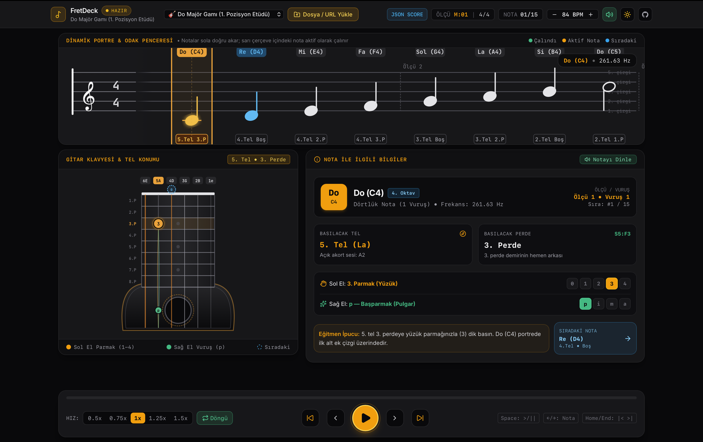

# 🎸 FretDeck — Modern Gitar Öğretim Konsolu



> **Not:** Bu depo **FretDeck** masaüstü uygulamasının resmi dağıtım (Releases-Only) sayfasıdır. Uygulamanın en güncel kurulum dosyalarını sağ taraftaki **[Releases](../../releases/latest)** bölümünden ücretsiz indirebilirsiniz.

---

## ⬇️ İndirme Bağlantıları (Ücretsiz)

| İşletim Sistemi | Paket Türü | İndirme |
| :--- | :--- | :--- |
| 🍎 **macOS (Apple Silicon — M1/M2/M3/M4)** | `.dmg` Kurulum İmajı | **[Son Sürümü İndir (.dmg)](../../releases/latest)** |
| 🍎 **macOS (Intel)** | `.dmg` Kurulum İmajı | **[Son Sürümü İndir (.dmg)](../../releases/latest)** |
| 🪟 **Windows 10 / 11 (64-bit)** | `.exe` / `.msi` Kurulum Sihirbazı | **[Son Sürümü İndir (.exe)](../../releases/latest)** |
| 🐧 **Linux (Ubuntu / Debian / Fedora)** | `.AppImage` / `.deb` | **[Son Sürümü İndir (.AppImage)](../../releases/latest)** |

---

## ✨ Öne Çıkan Özellikler

- **Dinamik Sola Kayan Nota Portresi & Odak Penceresi**: Notalar sağdan sola akıcı şekilde kayar; sabit odak penceresi o an çalınacak notayı vurgular.
- **Dikey Gitar Klavyesi & Gövdesi**: 6 tel ve perdeler üzerinde basılacak noktayı, sol el parmak numarasını (`0`–`4`), sağ el vuruş parmağını (`p`, `i`, `m`, `a`) ve sıradaki notayı canlı olarak gösterir.
- **Nota Bilgi Paneli (Inspector)**: Türkçe ve evrensel nota adı (`Do • C4`), frekans (`Hz`), tel/perde konumu, parmak rehberi ve eğitmen ipuçları sunar.
- **Gerçekçi Web Audio Gitar Sentezleyicisi**: İnternet bağlantısı gerektirmeden dahili akustik gitar ses motoru ve metronom ile çalışır.
- **Çoklu Format & Uzak URL Desteği**: `.json`, `.xml`, `.musicxml`, `.tab` dosyalarını sürükleyip bırakarak veya doğrudan URL adresinden yükleyin.

---

## 🛠️ Kurulum ve İlk Açılış Rehberi

### 🍎 macOS Kurulumu

1. İndirdiğiniz `.dmg` dosyasını açın ve **FretDeck** ikonunu **Applications (Uygulamalar)** klasörüne sürükleyin.
2. Uygulama bağımsız olarak dağıtıldığı için ilk açılışta macOS Gatekeeper uyarısı görebilirsiniz:
   - **Yöntem 1**: `Applications` klasöründe **FretDeck** üzerine **Sağ Tıklayın → Aç (Open)** seçeneğine tıklayın.
   - **Yöntem 2**: Terminal'i açıp şu komutu yapıştırın:

     ```bash
     xattr -cr /Applications/FretDeck.app
     ```

### 🪟 Windows Kurulumu

1. İndirdiğiniz `FretDeck_x64-setup.exe` dosyasını çift tıklayarak çalıştırın.
2. Windows SmartScreen mavi uyarı penceresi çıkarsa **"Ek bilgi (More info)"** bağlantısına tıklayıp **"Yine de çalıştır (Run anyway)"** butonuna basın.

### 🐧 Linux Kurulumu

- **AppImage**:

  ```bash
  chmod +x FretDeck_*.AppImage
  ./FretDeck_*.AppImage
  ```

- **Debian / Ubuntu (.deb)**:

  ```bash
  sudo dpkg -i FretDeck_*.deb
  ```
